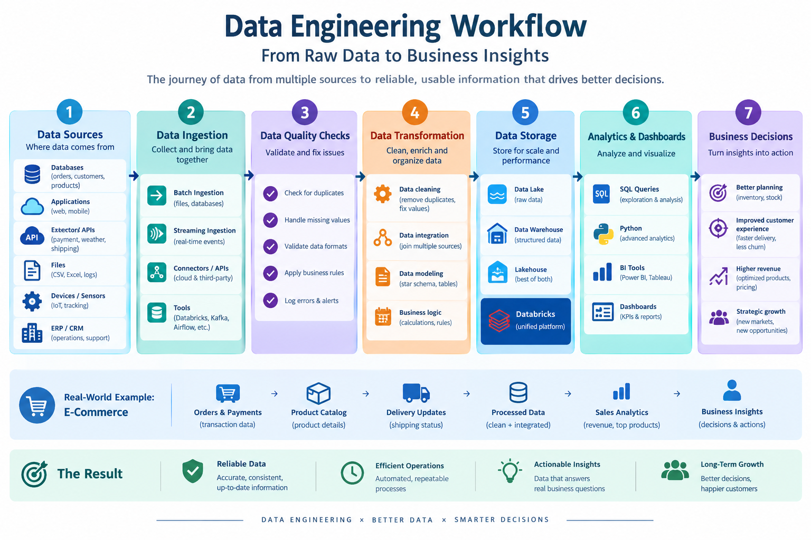

# Data Engineering Foundations & Databricks

A beginner-friendly portfolio project exploring how raw data is transformed into reliable information for analytics and business decision-making.

## Article

Read the full article in [`article.md`](article.md).

## Workflow Diagram

The diagram shows a typical flow from data sources through ingestion, data quality checks, transformation, storage, analytics, and business decisions. The e-commerce example illustrates how orders, product data, and delivery updates can be combined to support business insights.

## Topics Covered

- Introduction to Data Engineering, data sources, and data pipelines
- Why data quality, reliability, and accessibility matter
- Data Engineer vs. Data Analyst
- Databricks Workspace, Compute, and Notebooks
- OLTP vs. OLAP
- An e-commerce example connecting data engineering with business analytics

## Example Business Scenario

An e-commerce company combines order, product, payment, and delivery information. A data pipeline validates and transforms the records, then makes the prepared data available for analysis. A Data Analyst can use SQL and a BI tool to investigate revenue, product performance, cancellations, and delivery trends.

## References

- [AWS — What Is a Data Pipeline?](https://aws.amazon.com/what-is/data-pipeline/)
- [AWS — What Is an ETL Pipeline?](https://aws.amazon.com/what-is/etl-pipeline/)
- [Databricks Documentation — Compute](https://docs.databricks.com/aws/en/compute/)
- [Databricks Documentation — Notebooks](https://docs.databricks.com/aws/en/notebooks/)
- [Databricks Documentation — Workspace](https://docs.databricks.com/aws/en/admin/workspace)
- [Microsoft Learn — Data Performance and OLTP/OLAP](https://learn.microsoft.com/en-us/azure/well-architected/performance-efficiency/optimize-data-performance)

## How to Use This Repository

1. Review and personalize `article.md`, especially the personal learnings section.
2. Keep the workflow image in the `images` folder so the Markdown image displays correctly.
3. Publish the article on LinkedIn Articles.
4. Add the published article URL to your LinkedIn announcement post.
5. After creating a public GitHub repository, use its URL in the assignment submission form.

## Note

This is a learning project with illustrative business examples. The workflow is a simplified representation; actual architectures vary based on requirements and technology choices.
